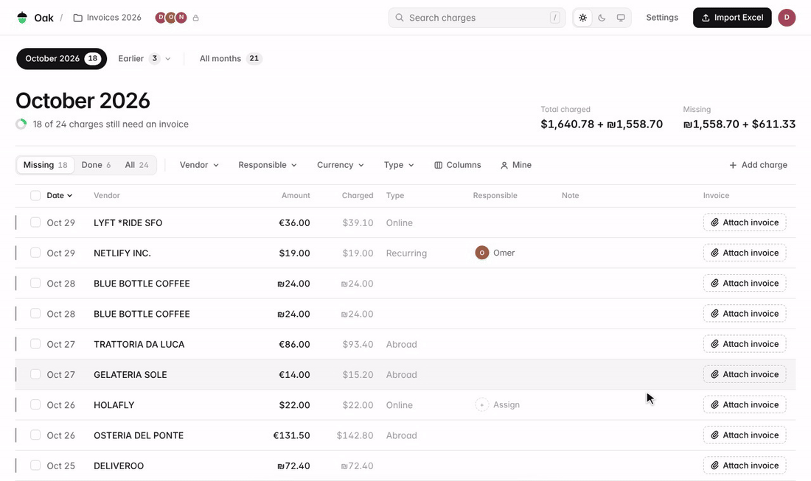
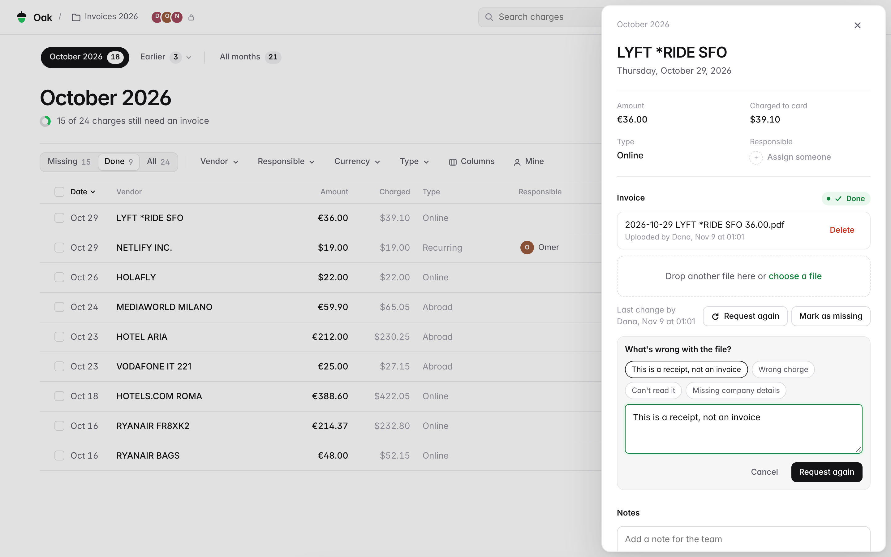
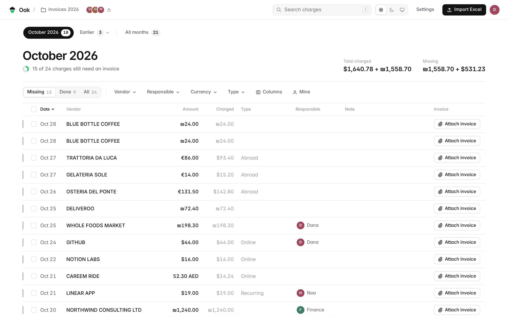
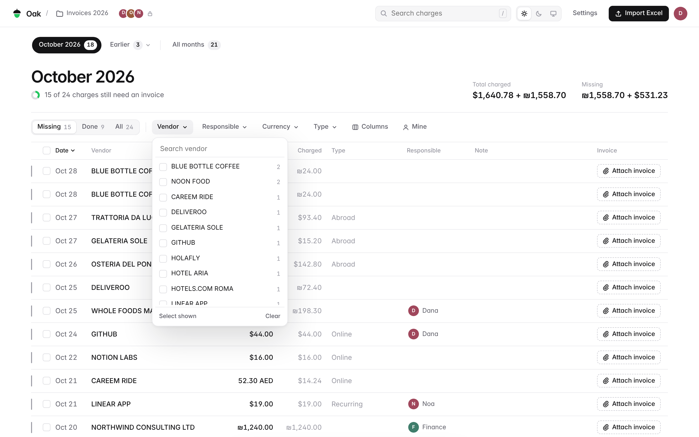
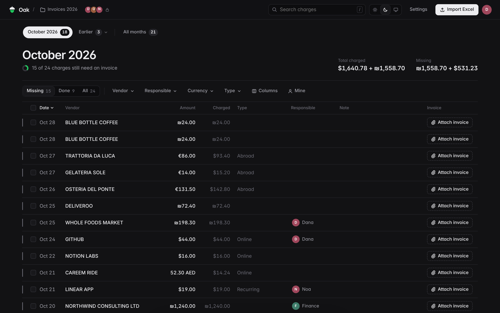
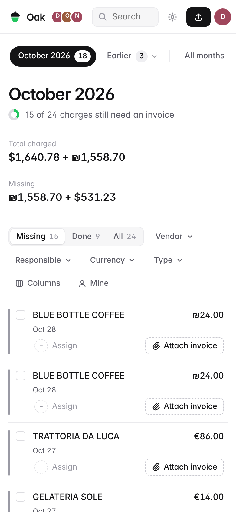
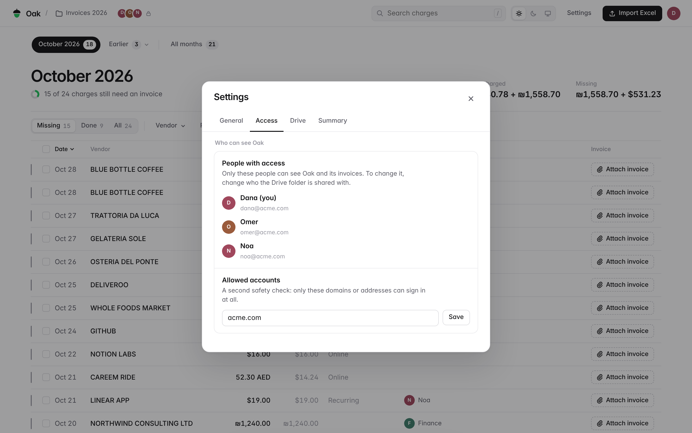

<h1 align="center">Oak</h1>

<h3 align="center">Every card charge, matched to its invoice. Import the monthly card statement, see what's still missing, and drop invoices in. The whole team works from one list, and every file lands in your own Google Drive.</h3>

  
  
  
  

**No more "who has the hotel invoice from the 14th?"** Oak replaces the monthly email thread between finance and
everyone holding a company card.

## What you get

- **Any Excel, any layout.** Drop in the card statement as it comes from the bank. Oak finds the date, vendor,
  amount and currency columns by itself, reads every sheet in the file, and lets you fix the mapping or keep extra
  columns (card, project, anything). Importing again only adds new charges, so nothing you've done is lost.
- **Or add it by hand.** A cash expense or a charge from another card? **Add charge** puts it on the list with
  everything else.
- **Drop the invoices, Oak sorts them.** Drop one file or a whole pile anywhere on the page, or tap **Upload
  invoices** on your phone. Oak reads each one, scans and photos included, finds the amount, vendor, date and
  invoice number, and attaches it to its charge. Only the files it isn't sure about wait for you to pick.
- **Invoice numbers, kept.** Each invoice number has its own column in the list, is saved in the data sheet, and
  you can search by it. Drop the same invoice twice and Oak tells you instead of attaching it again. For invoices
  attached earlier, **Settings → Drive → Read numbers** fills them in.
- **Your Drive stays tidy.** Every invoice is saved to your Drive folder, renamed to
  `2026-10-21 LINEAR APP 19.00 USD.pdf` and sorted into a folder per month. Delete it in Oak and it moves to Drive's trash too.
- **Done means done.** Once a charge has its invoice it's marked done, so nobody goes looking for it again.
- **Or lost.** If an invoice can't be found, mark the charge as **Lost**. It stops counting as missing and has its own tab.
- **Request again.** Got a receipt instead of a tax invoice? Reopen the charge with a reason ("This is a receipt,
  not an invoice") and the person who uploaded it sees what to send.
- **One person per charge.** Assign whoever has to find it. Filter by vendor, person, currency, type or status,
  see the totals of what's charged and what's still missing, and switch to **Mine** for your own list.
- **Preview without leaving.** Open any invoice in the side panel, with notes and a history of who did what.
- **Monthly summary.** On the 1st of each month, Oak emails finance what's still missing.
- **Works everywhere.** Light and dark themes, right-to-left text, and a layout made for phones.

## Who can see it

- **Only the people your Drive folder is shared with.** Oak shows exactly who has access, right in the top bar.
- **A second lock.** In **Settings → Access** you can limit sign-in to your domains or to specific addresses, even
  if someone gets the link.
- **Everyone signs in as themselves.** Oak runs with each person's own Google account, so the Activity log shows
  who uploaded, assigned or deleted what.

## Privacy

- **No Oak server.** Oak is a Google Apps Script web app that runs in your own Google account. There's no
  account to create, nothing to host and nothing to pay.
- **Your data stays in your Google Workspace.** Charges are kept in a Google Sheet inside your Drive folder, and
  invoices are files in that same folder.
- **No tracking.** Oak has no analytics. Invoices are read by Google Drive's own text recognition, inside your
  account. Apart from Google, the only thing Oak loads is an open-source library for reading Excel files, from cdnjs.

## Set it up (about 10 minutes)

Do this once, signed in with the Google account that should own the invoices (usually finance).

1. **Make a Drive folder** for the invoices, for example "Invoices". Share it as **Editor** with everyone who'll use Oak.
2. **Create the script.** Go to [script.google.com](https://script.google.com), click **New project** and name it
   "Oak". In **Project Settings** (the gear), turn on **Show "appsscript.json" manifest file in editor**.
3. **Paste the four files** from this repo:
   - `Code.gs` → replace the contents of `Code.gs`
   - `appsscript.json` → replace the contents of `appsscript.json` (change `timeZone` to yours)
   - Click **+ → HTML**, name it `Index` (no extension), and paste `Index.html`
   - Click **+ → Script**, name it `Invoice`, and paste `Invoice.gs`
4. **Deploy.** Click **Deploy → New deployment**, choose **Web app**, and set:
   - Execute as: **User accessing the web app**
   - Who has access: **Anyone with Google account**

   Click **Deploy** and approve the permissions. Oak itself only lets in the people you allow (step 6).
5. **Open the web app link** and paste the link of your Drive folder. Oak creates its data sheet inside it.
6. **Choose who can sign in** under **Settings → Access**, for example `yourcompany.com`. You can also set this in
   code with `ALLOWED` at the top of `Code.gs`.
7. **Send the link to your team.** That's it.

**The first time someone opens Oak,** Google shows "Google hasn't verified this app". That's normal for an app
you run yourself: click **Advanced → Go to Oak (unsafe) → Allow**. Each person sees this once.

## Updating

**From the editor:** paste the new files, then **Deploy → Manage deployments → ✏️ → Version: New version → Deploy**.
The link stays the same.

**From your computer (Windows, one click):**

1. Install [Node.js](https://nodejs.org), then run `npm install -g @google/clasp` and `clasp login`.
2. Turn on the Apps Script API at [script.google.com/home/usersettings](https://script.google.com/home/usersettings).
3. In this folder run `clasp clone <script ID>` (find it in **Project Settings**), then copy this repo's files back over the cloned ones.
4. Put your web app's **Deployment ID** (**Deploy → Manage deployments**) in a file called `deployment.txt`.

After that, double-click **update.cmd** whenever the code changes.

## FAQ

**Does it cost anything?**
No. It runs on Google Apps Script, which is included with every Google account.

**Which card statements does it read?**
Any `.xlsx`, `.xls`, `.xlsm` or `.csv` with a date, a vendor and an amount. Oak guesses the columns and shows you a preview
before importing. Status columns like "OK" or "Missing" are picked up too.

**What happens if someone imports the wrong file, or the same file twice?**
Charges are matched by date, vendor and amount, so the same charge is never added twice, and an import never deletes
or resets anything. A charge added by mistake can be deleted from its side panel.

**Finance deletes invoices from the Drive folder once they're handled. Is that a problem?**
No. A charge stays done when its file is removed from Drive, and the side panel notes that the file was removed.

**Someone dropped files straight into the Drive folder. Now what?**
Open **Settings → Drive → Match files**. Oak lists the files that aren't attached yet and suggests a charge for each.

**Someone gets a blank white page.**
They're signed in to more than one Google account, and Google opened Oak with the wrong one. Open the link in a
browser profile (or an incognito window) signed in only with the work account.

**Who owns the uploaded files?**
The person who uploaded them, inside your shared folder, like any file they'd add to Drive themselves.

**Can two companies use it?**
Yes, but give each company its own copy: its own script, its own Drive folder, its own link. That keeps their
invoices fully apart.

**Is this affiliated with Google?**
No. Oak is an independent open-source project that runs on Google Apps Script.

## About

Oak started as a fix for one finance team's monthly chase for invoices, and that team now uses it every month. It was built by [Itay Nadir](https://github.com/itay5731), vibe coded with AI, and tested against real
card statements.

## License

[MIT](LICENSE) © 2026 Itay Nadir. Oak uses [SheetJS](https://sheetjs.com) under its own license.

Google, Google Drive and Google Workspace are trademarks of Google LLC.
